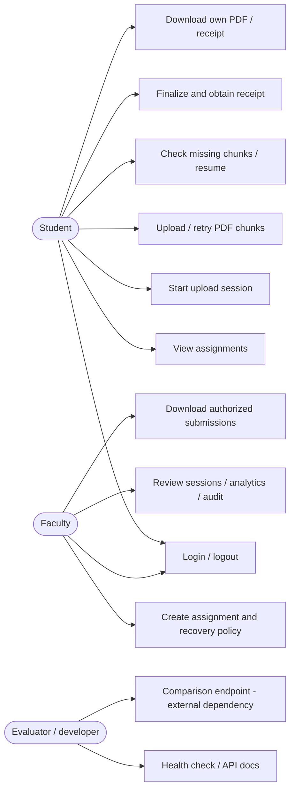
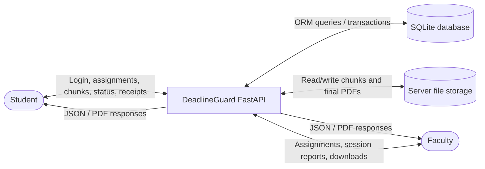
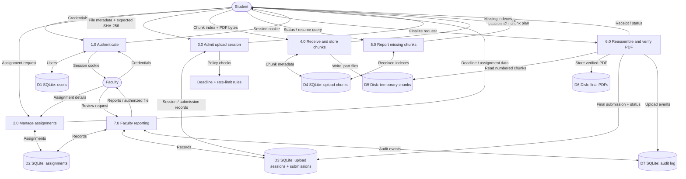
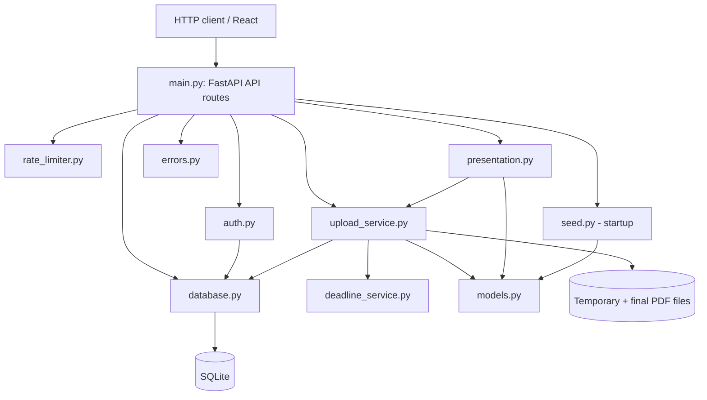
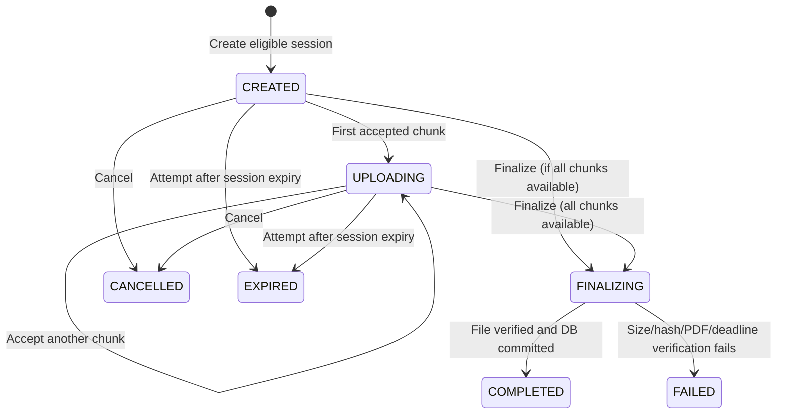
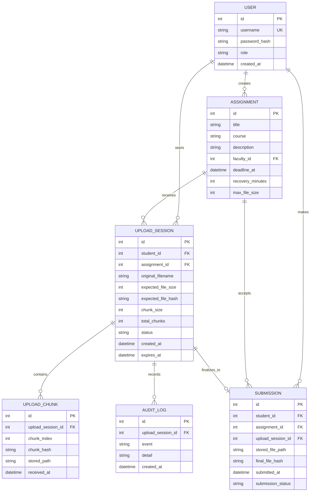

# DeadlineGuard
## Deadline-Aware Assignment Submission and Server Overload Protection System

**Project documentation | Backend-focused, source-grounded edition**  
**Prepared:** 27 October 2026  
**Audience:** CSE project reviewers, mentors, developers and demonstrators

> **Source/version note:** This document describes the *latest* backend files supplied for review (`main.py`, `rate_limiter.py`, `database.py`, `models.py`, `upload_service.py`, `auth.py`, `deadline_service.py`, `presentation.py`, `seed.py`, `errors.py`, `requirements.txt`, `README.txt`). The uploaded files use imports such as `from database import ...`, and their README specifies port **8002**. Earlier versions of DeadlineGuard used different routes, imports, credentials and ports; do not mix them. The frontend source and experiments implementation for this exact backend revision have **not** been audited as an integrated unit. Accordingly, diagrams of user interaction are *workflow views inferred from the backend API*, not a claim that each corresponding frontend screen was verified.

---

## Contents

1. Project summary and problem statement
2. Objectives, scope and user roles
3. Use cases and user journey
4. Architecture and data-flow diagrams
5. Upload lifecycle and deadline rules
6. Technology stack and repository modules
7. Database design and data dictionary
8. Backend function reference
9. API reference
10. Algorithms and worked examples
11. Security, reliability and limits
12. Local setup and verification
13. Testing and evaluation plan
14. Related research and references
15. Viva preparation

---

## 1. Project Summary and Problem Statement

**DeadlineGuard** is a prototype academic assignment submission backend intended to help students complete eligible PDF uploads under deadline pressure, while limiting resource consumption. It uses authenticated student/faculty roles, controlled creation of upload sessions, chunk-based file transfer, resumable progress, a faculty-configured post-deadline recovery period, SHA-256 file integrity verification, and recorded submission receipts.

### The motivating problem

Many students may submit at approximately the same time. A basic upload flow can be interrupted by network loss or timeouts, potentially forcing a student to retransmit an entire file. A coarse rate limiter can also count an already-started file transfer against the same budget as attempts to create new transfers. At deadline boundaries, submission eligibility must be decided consistently by the server rather than the student's device clock.

### What this prototype implements

- Student/faculty authentication using HTTP-only session cookies and password hashes.
- Assignments with UTC deadlines, maximum file size and recovery period.
- Upload-session admission checks and per-user sliding-window rate limits.
- 512 KiB chunk uploads, received-chunk tracking and missing-chunk reporting.
- SHA-256 comparison when reconstructing a final PDF; basic PDF validation with `pypdf`.
- On-time versus grace-recovered submission classification and JSON receipts.
- Faculty queries for submitted files, upload sessions, audit history and counts.
- Endpoint exposing an *external* performance-comparison module (implementation not supplied).

**Do not claim** this prototype proves higher throughput, eliminates server crashes, provides distributed rate limiting, or guarantees uploads under every outage. Such claims require measured experiments and stronger fault tolerance.

---

## 2. Objectives, Scope and User Roles

### Objectives

1. Control admission of new upload sessions during periods of high request volume.
2. Avoid discarding successfully received portions of an interrupted file.
3. Apply an authoritative server-side deadline and an explicit recovery policy.
4. Reject duplicate or conflicting chunks and duplicate finalized submissions.
5. Verify the reconstructed file matches the committed SHA-256 and is an acceptable PDF.
6. Make submission status visible to students and faculty.
7. Evaluate a naive shared request limit against a session-aware request limit using repeatable workloads.

### System users / actors

| User / actor | Goal | Supported backend actions | Restrictions |
|---|---|---|---|
| **Student** | Submit PDF assignments reliably | Login, view assignments, start upload, PUT chunks, inspect status, resume, finalize, cancel, view/download own submission and receipt | Cannot create faculty assignments; uploads must begin before deadline; at most one final submission per assignment |
| **Faculty** | Manage assignments and review evidence | Login, create assignments, view own assignments, view submissions, inspect audit events and session counts, download accessible PDFs | Faculty views are scoped to their own assignments; not permitted to start student upload sessions |
| **Server / scheduler** | Enforce policies and maintain data | Validate deadline, rate limits, chunk integrity, session state, database transaction | Server time is authoritative; no autonomous background recovery worker is shown in the source |
| **Evaluator / developer** | Inspect behavior and compare policies | Use Swagger docs, inspect logs, call comparison endpoint if dependencies exist, run manual/automated tests | Comparison module and measured output were not uploaded for verification |

### Use-case diagram



---

## 3. User Journey and Functional Requirements

### Student journey

1. Student signs in. On success the server returns the user profile and sets `dg_session`.
2. Student fetches available assignments, deadlines and any saved upload-session details.
3. Student selects a PDF. The client must calculate the file's SHA-256 digest and size before calling `POST /api/uploads/start`.
4. The server checks authentication, rate limit, assignment, deadline, size, duplication and session count.
5. A new or matching unfinished session is returned with chunk information.
6. The client sends numbered chunks using `PUT /api/uploads/{session_id}/chunks/{chunk_index}`.
7. If disconnected, the student signs in again if necessary, identifies an existing session and checks which chunk indexes are missing.
8. Only missing chunks need be retransmitted, subject to session eligibility.
9. Student calls finalize. The server reassembles the PDF in index order, validates it, inserts a submission row and marks the session completed.
10. Student receives a JSON receipt and can retrieve their stored file.

### Faculty journey

1. Faculty signs in and is authorized through `require_faculty()`.
2. Faculty creates an assignment with a timezone-aware deadline, recovery minutes and file-size cap.
3. Faculty sees submissions and session states belonging to their assignments.
4. Faculty can inspect events for a particular upload session, and download submissions belonging to their assignments.

### Illustrative deadline scenario

Assume a deadline of 23:59 and a configured recovery period of 5 minutes. If a session is created at 23:57, the student can transmit and finalize after 23:59 but **before** 00:04, subject to validation. A *new* session requested at 23:59 is rejected. The recovery window is **not** permission to begin an entirely new submission after the deadline.

---

## 4. Architecture and Data Flows

### 4.1 Level-0 context diagram



### 4.2 Level-1 data flow diagram (DFD)



**Data-flow interpretation:** SQLite stores metadata and references to files; the actual PDF bytes are stored on disk under the configured storage directory. Authentication tokens are stored in an **in-memory `SESSIONS` dictionary**, not in SQLite. The rate limiter also holds request timestamps in memory.

### 4.3 Backend module dependency diagram



### 4.4 Sequence diagram: full upload

```mermaid
sequenceDiagram
    actor Student
    participant Browser as Browser / HTTP client
    participant API as main.py (FastAPI)
    participant Rule as Rate + deadline checks
    participant Upload as upload_service.py
    participant DB as SQLite
    participant Disk as File storage

    Student->>Browser: Select PDF and start
    Browser->>API: POST /api/uploads/start (metadata, expected hash)
    API->>Rule: Check user limit and deadline
    Rule-->>API: Permit or reject
    API->>Upload: create_upload_session(...)
    Upload->>DB: INSERT upload session + audit event
    DB-->>Upload: Session ID
    Upload-->>Browser: Session metadata
    loop For each missing chunk
        Browser->>API: PUT /api/uploads/{id}/chunks/{index}
        API->>Upload: receive_chunk(...)
        Upload->>Disk: Write numbered .part file
        Upload->>DB: INSERT chunk metadata
        Upload-->>Browser: Stored / already_received
    end
    opt Connection interrupted
        Browser->>API: GET /api/uploads/{id}/status
        API->>Upload: get_upload_status(...)
        Upload->>DB: Query received chunk indexes
        Upload-->>Browser: List of missing chunks
    end
    Browser->>API: POST /api/uploads/{id}/finalize
    API->>Upload: finalize_submission(...)
    Upload->>Disk: Read parts in order; write assembled PDF
    Upload->>Upload: Verify size, hash and PDF structure
    Upload->>DB: INSERT submission; mark COMPLETED; audit
    Upload-->>Browser: Receipt
    Browser-->>Student: Show submission result
```

### 4.5 Data movement: what is stored where?

| Data | Origin | Destination | Purpose |
|---|---|---|---|
| Username/password | Login form | `auth.py` → Users table lookup | Establish identity; submitted password is verified against stored hash |
| Login cookie | `main.login()` | Browser cookie + in-memory session registry | Identify user on later requests |
| Assignment + deadline | Faculty input | `assignments` table | Define submission policy |
| Filename, size, SHA-256 | Student client | `upload_sessions` table | Define expected file for session |
| Chunk bytes | HTTP PUT body | Disk: `tmp/{session_id}/{index}.part` | Preserve upload progress |
| Chunk hash/index/path | `receive_chunk()` | `upload_chunks` table | Track received data and identify duplicates |
| Reconstructed PDF | `finalize_submission()` | Disk: `final/{assignment}_{student}_{session}.pdf` | Preserve accepted PDF |
| Receipt metadata | `Submission` + `UploadSession` | SQLite → JSON response | Proof of backend-recorded finalization |
| Audit event | Service operation | `audit_log` table | History of significant session changes |

---

## 5. Upload Lifecycle and Deadline Rules

### State machine



**Notes:** `EXPIRED` is marked when a request detects expiry; the source does not show a periodic cleanup job. A crash during `FINALIZING` can leave the state unresolved; automated restart recovery is not implemented in these supplied files.

### Deadline policy

- `check_new_session()` allows a *new* upload session only when `now < assignment.deadline_at`.
- `session_expiry()` computes `deadline_at + recovery_minutes`.
- `check_existing_session()` allows continuation before the deadline or while `now < session.expires_at`.
- `classify_submission()` uses the final server timestamp to return `SUBMITTED_ON_TIME` or `RECOVERED_WITHIN_GRACE`.
- Boundaries use strict `<`. A request *at* the expiration instant is rejected.

---

## 6. Technology Stack and Modules

| Layer | Technology | Verified purpose |
|---|---|---|
| HTTP API | FastAPI / Uvicorn | Routing, request/response lifecycle, dependency injection, Swagger UI |
| Data validation | Pydantic | Typed login, assignment and upload metadata inputs |
| Database ORM | SQLAlchemy | Models, queries, transactions, constraints |
| Database | SQLite | Local persistent metadata |
| File storage | Python `pathlib`, standard filesystem | Temporary chunk files and final PDFs |
| Hashing | Python `hashlib`, `secrets` | Password hashes, random login tokens, file SHA-256 |
| PDF validation | `pypdf` | PDF readability, encryption and page count |
| Concurrency | `threading.Lock`, `RLock`, `BoundedSemaphore` | Process-local serialization and bounded active transfers |
| Browser client | React/Vite (related files existed in earlier uploads) | Exact compatibility with this backend revision not independently established |

### File-by-file responsibilities

- **`main.py`**: FastAPI application, middleware, routes and response handling.
- **`auth.py`**: Password hashing, token creation, cookie authentication, faculty authorization.
- **`rate_limiter.py`**: Sliding-window policy; naive and session-aware configurations.
- **`database.py`**: SQLite engine, connection settings and session dependency.
- **`models.py`**: Six ORM tables and `utcnow()` helper.
- **`deadline_service.py`**: UTC conversion, upload eligibility and classification.
- **`upload_service.py`**: Core session/chunk/resume/finalization logic.
- **`presentation.py`**: Convert ORM/service values to frontend-compatible output.
- **`seed.py`**: Add initial demonstration accounts and sample assignments.
- **`errors.py`**: Shared custom exception type.

---

## 7. Database Design

### Entity relationship diagram (simplified)



**Database safeguards:**

- `users.username` is unique.
- `(upload_session_id, chunk_index)` is unique in `upload_chunks`.
- `(student_id, assignment_id)` is unique in `submissions`, limiting each student to one finalized submission per assignment.
- Foreign-key checks are explicitly enabled through a SQLite PRAGMA.
- WAL (write-ahead logging) is enabled for improved reader/writer behavior in this local database, not unlimited concurrent writes.

---

## 8. Backend Function Reference

### 8.1 `deadline_service.py`

| Function | Arguments | Result / purpose |
|---|---|---|
| `to_naive_utc(dt)` | Datetime | Normalize timezone-aware date to naive UTC |
| `session_expiry(assignment)` | Assignment | Deadline plus recovery minutes |
| `check_new_session(assignment, now=None)` | Assignment, optional timestamp | `(allowed, reason)`; only before deadline |
| `check_existing_session(session, assignment, now=None)` | Session, assignment, time | `(allowed, reason)`; checks session expiry |
| `classify_submission(assignment, now=None)` | Assignment, time | `SUBMITTED_ON_TIME` or `RECOVERED_WITHIN_GRACE` |

### 8.2 `rate_limiter.py`

| Function / method | Purpose |
|---|---|
| `SlidingWindowLimiter.__init__` | Store window, request cap, timestamp deques and lock |
| `SlidingWindowLimiter.allow` | Lock and evaluate an incoming user request |
| `_allow_locked` | Drop expired timestamps, reject or append current request |
| `check_rate_limit(user_id, kind)` | Select naive shared limiter or session-aware budget |
| `reset()` | Clear timestamp dictionaries; intended mainly for controlled experiments/tests |

**Prototype constants:** Naive mode = 30 requests/minute; session-aware mode = 3 new sessions/minute, 240 continuation requests/minute. `MODE['value']` defaults to `session_aware`. Allowed requests are tracked by user ID. Rejected requests are not appended to the deque.

### 8.3 `auth.py`

| Function | Purpose |
|---|---|
| `hash_password(password, salt=None)` | PBKDF2-HMAC-SHA256 with random salt and 200,000 iterations |
| `verify_password(password, stored)` | Recompute password hash and compare with `secrets.compare_digest` |
| `create_login_token(user_id)` | Generate 32-byte random token represented as hex; store token → user ID in RAM |
| `get_current_user(dg_session, db)` | Read cookie, resolve user, return 401 if unauthenticated |
| `require_faculty(user)` | Allow faculty only, otherwise raise 403 |

**Note:** There is no password-reset flow, persistent token store or distributed session backend in the supplied code.

### 8.4 `database.py`, `models.py`, `seed.py`, `errors.py`

| Symbol | Purpose |
|---|---|
| `configure_sqlite(connection, _)` | Activate foreign keys and WAL for new DB connections |
| `get_db()` | FastAPI generator dependency that yields a DB session and then closes it |
| `utcnow()` | Server UTC clock represented as naive UTC datetime |
| `seed_demo()` | Creates tables, demo accounts and initial assignments if missing |
| `AppError.__init__(status_code, message, extra)` | Records app error fields for FastAPI JSON handler |
| `User`, `Assignment`, `UploadSession`, `UploadChunk`, `Submission`, `AuditLog` | ORM model classes representing persistent entities |

### 8.5 `upload_service.py` (most important module)

| Function | Inputs / key steps | Output or error |
|---|---|---|
| `write_audit` | Add upload event to current DB session | Adds `AuditLog` row; caller commits |
| `get_owned_session` | Lookup session, match `student_id` | Session or HTTP 404 |
| `create_upload_session` | Role, assignment, deadline, file size/hash, duplicates, active count; compute chunks and expiry | Session or 403/404/409/413/429 |
| `receive_chunk` | Confirm ownership/state/expiry/index/expected bytes; hash data, reject conflicting retry, write `.part`, insert metadata | Chunk acknowledgment or error |
| `received_indexes` | Query stored chunk indexes | Sorted integer list |
| `chunk_status` | Count received chunks | Acknowledgment dictionary |
| `get_upload_status` | Build received and missing index lists | JSON-ready progress dictionary |
| `find_active_session` | Query unfinished session for user and assignment | Session or `None` |
| `cancel_upload` | Mark `CANCELLED`, record audit, delete temporary folder | Cancellation response |
| `submission_to_dict` | Convert submission + related records | Receipt-like dictionary |
| `fail_session` | Mark `FAILED`, remove optional final file, raise error | Raises HTTP 400 via `AppError` |
| `finalize_submission` | Check eligibility + missing parts; assemble, hash, verify PDF; insert final record, audit, delete temporary parts | Receipt dictionary or error |

#### Detailed explanation: `create_upload_session()`

1. Requires `student.role == 'student'`.
2. Loads the referenced assignment and rejects nonexistent IDs.
3. Checks deadline: new sessions may begin only before the deadline.
4. Validates file size (at most 25 MiB and the assignment cap) and 64-character SHA-256 hex digest.
5. Rejects an already-finalized submission for the same student and assignment.
6. Reuses an unfinished session with matching student, assignment, hash and size.
7. Limits students to two unfinished sessions (prototype policy).
8. Calculates `total_chunks = (file_size + CHUNK_SIZE - 1) // CHUNK_SIZE` and expiry.
9. Inserts session + `SESSION_CREATED` audit row, commits, returns the record.

#### Detailed explanation: `receive_chunk()`

1. Resolve session and verify ownership.
2. Reject non-active sessions or expired recovery window.
3. Validate `chunk_index` and exact byte length. All chunks except the final one are exactly 512 KiB; the last may be shorter.
4. Hash the received bytes with SHA-256.
5. If the index exists with the same hash, return `already_received`; with a different hash, return 409.
6. Write data to temporary `.tmp`, flush + `fsync`, then replace numbered `.part` file.
7. Insert chunk metadata and move the session to `UPLOADING`; commit.
8. Return `stored` and received counts.

**Why retry is safe:** A client might lose the server response even after the server saved the chunk. Repeating the identical chunk does not create a duplicate row.

#### Detailed explanation: `finalize_submission()`

1. Check session ownership and assignment.
2. If already completed, return the existing receipt (idempotent finalization).
3. Ensure session active, still eligible, and no chunk indexes missing.
4. Set status `FINALIZING` and commit.
5. Read `.part` files by index, write a full PDF, compute a running SHA-256.
6. Reject unexpected assembled length or mismatched final SHA-256.
7. Check PDF signature `%PDF`; use `PdfReader(..., strict=True)` and reject encrypted or unsupported 0 / >200 page PDFs.
8. Check the deadline again after verification.
9. Insert `Submission`, set status `COMPLETED`, add audit event and commit.
10. Remove temporary chunk directory and return receipt metadata.

**Failure case:** If the process terminates after `FINALIZING` is committed but before final completion, this code does not show automatic recovery from that state.

### 8.6 `presentation.py`

| Function | Purpose |
|---|---|
| `timestamp(value)` | UTC datetime to Unix timestamp |
| `upload_view(db, user, session)` | Convert service session status to frontend-compatible fields |
| `receipt_view(db, sub)` | Add display-oriented receipt keys, user name, title, status label and timestamps |

### 8.7 `main.py`: helpers and request handlers

| Function / class | Purpose |
|---|---|
| `lifespan` | Run demo-data seeding on app startup |
| `local_browser_safety` | Reject certain browser requests from unapproved origins; set `nosniff` and API `no-store` headers |
| `health` | Return status and server time |
| `handle_app_error` | Turn custom errors into JSON and optional `Retry-After` header |
| `LoginBody` | Validate username and password request JSON |
| `AssignmentBody` | Validate assignment details, timezone and limits |
| `StartUploadBody` | Validate file metadata, allowing certain legacy alias fields |
| `enforce_limit` | Raise 429 when rate limiter rejects a user request |
| `iso` | Render datetime as ISO-style UTC string |
| `login` | Validate password, set `dg_session`, return profile |
| `logout` | Remove matching tokens, clear cookie |
| `me` | Return logged-in profile |
| `assignment_to_dict` | Shape one assignment response |
| `create_assignment` | Faculty-only assignment insertion |
| `list_assignments` | Query assignments plus submission / active session context |
| `start_upload` | Enforce admission then create/reuse upload session |
| `upload_chunk` | Limit request rate + four transfer slots; stream bounded request body with 30-second timeout |
| `save_chunk` | Serialize mutation and call `receive_chunk` from worker thread |
| `upload_status` | Return upload status through presentation layer |
| `active_upload` | Find active session for assignment |
| `finalize` | Invoke finalization and render receipt |
| `cancel` | Cancel active session |
| `my_submissions` | Return student's compact submission list |
| `download` | Authorized PDF `FileResponse` |
| `faculty_submissions` | Query faculty-owned submissions with optional filters |
| `audit` | Return audit events for a faculty-owned assignment's session |
| `faculty_analytics` | Aggregate submissions and session status counts |
| `faculty_sessions` | Return faculty-scoped upload sessions and chunk counts |
| `session_for_frontend` | Compatibility route for a session representation |
| `submissions_for_frontend` | Frontend-friendly user/faculty receipt list |
| `authorized_submission` | Enforce student ownership or faculty ownership of assignment |
| `receipt_download` | Download JSON receipt as attachment |
| `demo_file` | Serve bundled 5/20 MiB sample PDF if present |
| `comparison` | Delegate to external `experiments.compare_limiters.run_comparison` (not supplied) |

**Key FastAPI syntax:** `@app.post('/path')` registers a handler; `Depends(get_db)` injects a managed DB session; `Depends(get_current_user)` authenticates via cookie. `async def upload_chunk` receives a streaming body and uses `run_in_threadpool` for blocking service work.

---

## 9. API Reference

All routes below are present in the uploaded `main(1).py`.

| Method | Route | Actor | Purpose |
|---|---|---|---|
| GET | `/api/health` | Anyone | Health check |
| POST | `/api/auth/login` | Anyone | Authenticate and set cookie |
| POST | `/api/auth/logout` | Logged in | Logout |
| GET | `/api/auth/me` | Logged in | Current profile |
| POST | `/api/assignments` | Faculty | Create assignment |
| GET | `/api/assignments` | Logged in | List assignments |
| POST | `/api/uploads/start` | Student | Create / reuse upload session |
| PUT | `/api/uploads/{session_id}/chunks/{chunk_index}` | Owning student | Upload one chunk |
| GET | `/api/uploads/{session_id}/status` | Owning student | Receive missing/received indexes |
| GET | `/api/uploads/active/{assignment_id}` | Logged in | Find active session |
| POST | `/api/uploads/{session_id}/finalize` | Owning student | Verify and submit |
| DELETE | `/api/uploads/{session_id}` | Owning student | Cancel upload |
| GET | `/api/uploads/{session_id}` | Owning student | Frontend-compatible status |
| GET | `/api/submissions/me` | Logged in | Compact own submission list |
| GET | `/api/submissions` | Logged in | Frontend-friendly scoped receipts |
| GET | `/api/submissions/{submission_id}/download` | Authorized user | Download final PDF |
| GET | `/api/submissions/{submission_id}/receipt` | Authorized user | Download receipt JSON |
| GET | `/api/faculty/submissions` | Faculty | List faculty submissions |
| GET | `/api/faculty/audit/{session_id}` | Faculty | Audit session |
| GET | `/api/faculty/analytics` | Faculty | Aggregate counts |
| GET | `/api/faculty/sessions` | Faculty | Inspect session states |
| GET | `/api/demo-files/{size}` | Logged in | Sample PDF (5 or 20 MiB, if file exists) |
| GET | `/api/comparison` | Logged in | External experiment runner |

### Example: start a session

```http
POST /api/uploads/start
Content-Type: application/json
Cookie: dg_session=<valid-token>

{
  "assignment_id": 1,
  "filename": "report.pdf",
  "file_size": 1200000,
  "file_hash": "<64 hexadecimal characters of the actual PDF's SHA-256>"
}
```

The API supplies a session identifier and total chunk count. The client must transmit raw bytes for each indexed chunk. Do **not** use a made-up hash for a real upload: finalization rejects a mismatch.

### Important status codes

- `200`: Successful request (most endpoints).
- `400`: Invalid chunk / missing data / integrity or PDF validation error.
- `401`: Missing/invalid authentication.
- `403`: Unauthorized role, disallowed origin or expired deadline policy.
- `404`: Record absent or not accessible; hides other users' session existence.
- `408`: Chunk transfer timed out.
- `409`: Conflict, such as duplicate submission or conflicting chunk.
- `413`: Chunk/file exceeds permitted size.
- `422`: Request validation error.
- `429`: Rate-limiter or concurrency rejection; may include `Retry-After`.

---

## 10. Algorithms and Worked Examples

### 10.1 Sliding-window admission

```text
allow(user_id, current_time):
    lock timestamp collection
    discard accepted-request timestamps older than 60 seconds
    if recent accepted request count >= configured limit:
        return (False, seconds_until_oldest_expires)
    append current timestamp
    return (True, 0)
```

**Example:** New-session budget = 3/60 s. Accepted at `t=0,10,20`; attempt at `t=30` is rejected. At `t=60` the first record is stale and a new request can be admitted. The implementation uses `time.monotonic()` rather than wall-clock time for rate intervals and `deque.popleft()` for old timestamps.

**Complexity:** Timestamp insertion and popping from a deque are O(1) amortized; expiration may remove several old timestamps in one call. Stored timestamps are proportional to recent accepted requests per user. The global in-memory map of user keys does not have an eviction policy in the supplied code.

### 10.2 Chunk calculation

Given file size `N` and `C=512*1024` bytes per chunk:

```text
total_chunks = (N + C - 1) // C
```

For `N = 1,200,000` bytes, `C = 524,288`, there are **3 chunks**: 524,288 bytes, 524,288 bytes and 151,424 bytes.

### 10.3 Resumption algorithm

```text
received = query sorted indexes of existing chunks
missing = all valid indexes - received indexes
for each missing index:
    resend exactly that byte range
then finalize the session
```

The supplied service accepts individual chunks and reports missing indexes. The browser/client must implement the upload and retry loop.

### 10.4 Integrity verification

At start the client commits an expected SHA-256 value. Upon finalization the backend hashes the assembled byte stream in chunk order and compares it with the committed digest. Individual chunk digests are used to recognize exact retries and reject conflicting retransmissions. Hashes establish content consistency; they do **not** encrypt the PDF or prove when the student first created it.

---

## 11. Security, Reliability and Known Limits

### Existing safeguards

- Salted PBKDF2 password hashing, random login tokens, HTTP-only `SameSite=Strict` cookie.
- Current-user and faculty-role dependency checks.
- Upload-session ownership and authorized PDF downloads.
- Server-side deadline validation and SHA-256 integrity checks.
- Maximum upload size 25 MiB; chunk size 512 KiB; PDF validation requires readable, unencrypted PDF with 1–200 pages.
- Database unique constraints for duplicate chunk indexes and final submissions.
- Process-local mutation lock and at most four simultaneously admitted chunk transfers.

### Constraints reviewers should know

1. **Not distributed:** Rate limits, login sessions and locks live in a single Python process. Multiple worker processes would not share this state.
2. **Restart behavior:** A restart clears login sessions, but SQLite records and saved chunk files may remain.
3. **Crash consistency:** File writes and DB commits are not one atomic operation; partial finalization and orphan files are possible.
4. **No durable restart of `FINALIZING`:** No repair/reconciliation worker appears in the supplied source.
5. **Origin check is not full production CSRF protection:** A missing Origin is not rejected by the middleware, and deployment requires a fuller security review.
6. **Per-user rate limiting begins after authentication:** The supplied login route does not itself apply an explicit IP-based login rate limiter.
7. **No measured improvement in supplied files:** `/api/comparison` imports a separate experiments module, but that module and results were not supplied.
8. **Demo files are optional on disk:** The sample-file endpoint expects a `samples` directory and may fail if the requested PDF is absent.
9. **No claim of browser integration test:** Frontend files for this precise backend snapshot were not supplied as a verified matched build.
10. **PDF checks are limited:** A parseable PDF is not necessarily malicious-content-free; no malware scanner is shown.

---

## 12. Local Setup and Verification

### Backend configuration confirmed in uploaded README

From the project root, using the expected project layout:

```powershell
.venv\Scripts\python.exe -m uvicorn main:app --app-dir backend --host 127.0.0.1 --port 8002
```

The README also refers to `setup.ps1` and `start.ps1`, but those script contents were not included in this upload.

With the process running, visit:

- Health: `http://127.0.0.1:8002/api/health`
- Swagger API docs: `http://127.0.0.1:8002/docs`

### Demo accounts in `seed.py`

| Username | Role | Demo password |
|---|---|---|
| `faculty1` | faculty | `pass1234` |
| `student1` | student | `pass1234` |
| `student2` | student | `pass1234` |

**Never use these credentials in a public deployment.** The seed function creates accounts only if their usernames are absent; existing credentials may differ in a previously initialized database.

### Quick smoke checks

1. Start server and load `/api/health`, expect `status: ok`.
2. Open `/docs`, expand the documented endpoints.
3. Login as faculty, create an assignment with an explicit timezone in `deadline_at`.
4. Login as student, confirm assignments are returned.
5. Upload a real readable PDF and verify status, finalization and receipt.
6. Interrupt midway, query the saved session and retry missing indexes.
7. Review the faculty audit and submission results.

---

## 13. Testing and Evaluation Plan

All entries below are **test scenarios**, not claims that tests were executed.

| ID | Test | Expected behavior | Verification status |
|---|---|---|---|
| T01 | Access `/api/health` while running | HTTP 200 and `status: ok` | Not verified in this revision |
| T02 | Login with correct demo credentials | Login cookie set | Not verified in this revision |
| T03 | Wrong password | 401 | Not verified in this revision |
| T04 | Student attempts faculty assignment creation | 403 | Not verified in this revision |
| T05 | Start upload before deadline | Session created or matching one reused | Not verified in this revision |
| T06 | Start upload exactly at deadline | Rejected | Not verified in this revision |
| T07 | Send exact same chunk twice | Second call says `already_received` | Not verified in this revision |
| T08 | Overwrite same chunk index with different data | 409 | Not verified in this revision |
| T09 | Resume after interruption | Only missing chunk indexes require sending | Not verified in this revision |
| T10 | Finalize with missing chunks | 400 plus missing indexes | Not verified in this revision |
| T11 | Finalize with wrong file hash | Rejected, session marked failed | Not verified in this revision |
| T12 | Finalize before deadline | `SUBMITTED_ON_TIME` | Not verified in this revision |
| T13 | Finalize inside recovery window | `RECOVERED_WITHIN_GRACE` | Not verified in this revision |
| T14 | Finalize after recovery expiration | Rejected | Not verified in this revision |
| T15 | More than 3 new-session admissions in 60 seconds | Rejected with 429 | Not verified in this revision |
| T16 | Four simultaneous chunk transfers, then another | Further active request receives 429 | Not verified in this revision |
| T17 | Student downloads another student's submission | Not accessible | Not verified in this revision |
| T18 | Backend restart during ongoing upload | Must log in again; persisted chunks may remain | Not verified in this revision |
| T19 | Comparison endpoint without experiments package | Import error / endpoint failure | Dependency not supplied |

### Suggested metrics for a future study

- Percentage of uploads finalized successfully.
- Number and distribution of HTTP 429 responses.
- Median and high-percentile request latency.
- Median and high-percentile upload completion time.
- Bytes retransmitted after interruption.
- Completion rate of eligible sessions during recovery window.
- Peak active transfers and server resource usage.

**Fair comparison:** Use the same hardware, file sizes, user counts, traffic arrival pattern and network-failure model for naive versus session-aware settings. Report actual measurements with reproducible scripts; a design argument alone is not experimental proof.

---

## 14. Related Research and References

**Motivating research:**

Chen, X., and Heidemann, J. (2005). *Flash Crowd Mitigation via Adaptive Admission Control Based on Application-Level Observations*. ACM Transactions on Internet Technology, 5(3). DOI: https://doi.org/10.1145/1084772.1084776

This paper supports the general problem of flash-crowd web traffic and admission control. It does **not** establish that the specific DeadlineGuard workflow had not previously been implemented; the academic submission scenario and policy combination are the project's own application focus.

**Technical background for resumable transfers:**

Google Developers. *Resumable Media Uploads in the Google Data Protocol*. https://developers.google.com/gdata/docs/resumable_upload

Official library documentation:

- FastAPI: https://fastapi.tiangolo.com/
- SQLAlchemy: https://docs.sqlalchemy.org/
- Python hashlib: https://docs.python.org/3/library/hashlib.html
- SQLite: https://www.sqlite.org/docs.html

The research and documentation links are bibliographic pointers. This Markdown document does not claim that additional web searches or experiments were performed in the current generation step.

---

## 15. Viva Preparation — Common Mentor Questions

1. **What is the core purpose?** Keep legitimate deadline-bound submissions recoverable while controlling excessive new upload requests.
2. **Why not use one global rate limit?** Chunk transfers can require many HTTP requests; a single common budget can interfere with ongoing transfers.
3. **What is a sliding window?** It counts admitted requests within a moving time interval using timestamp collections.
4. **Why `time.monotonic()`?** Elapsed-time calculations should not depend on wall-clock adjustments.
5. **Why use a `deque`?** Fast removal of oldest timestamps with `popleft()`.
6. **Why a `Lock`?** Protect shared timestamp collections against concurrent thread updates.
7. **Why a semaphore?** Bound simultaneously active chunk-transfer sections, independently of per-minute limits.
8. **What is an upload session?** A record for an attempt, not a guaranteed completed submission.
9. **Why split a file into chunks?** Preserve acknowledged progress and retransmit only missing portions.
10. **Why 512 KiB?** Prototype tradeoff between request overhead and retry size, not a proven optimum.
11. **How does resumption work?** Query existing chunk indexes, identify missing ones, retransmit those, then finalize.
12. **What is idempotency?** Repeating the same operation has the same effect as one successful execution; identical chunk retries and completed-session finalization illustrate it.
13. **What does SHA-256 check?** Byte integrity against the expected hash, not encryption or authorship.
14. **Who decides the deadline?** Server UTC clock and stored assignment deadline.
15. **Can a new upload start during grace?** No; grace applies only to eligible existing sessions.
16. **What happens at exact expiry?** The code uses `<`, so the request is no longer eligible.
17. **Why use SQLAlchemy?** Define relational models and manage database queries and transactions from Python.
18. **Difference between `flush()` and `commit()`?** Flush sends pending statements inside the transaction; commit finalizes it.
19. **Why use `yield` in `get_db()`?** Allow FastAPI to provide a database session and perform cleanup afterward.
20. **Authentication vs authorization?** Identify the user versus decide which records/actions they may access.
21. **Why an HTTP-only cookie?** Reduce direct access to the session token from browser JavaScript.
22. **What happens after backend restart?** In-memory login tokens and rate histories vanish; SQLite and disk files may remain.
23. **Is this safe with multiple Uvicorn workers?** Not without redesigning process-local sessions, locks and rate counters.
24. **What prevents duplicate final submissions?** Application checks and a unique `(student_id, assignment_id)` database constraint.
25. **What happens if finalization crashes?** It may leave a `FINALIZING` record; restart reconciliation is a known missing feature.
26. **Does a valid PDF guarantee it is harmless?** No; no malware scanning is shown.
27. **Why separate file storage from database rows?** Store large byte content on disk while SQLite holds indexed metadata and paths.
28. **Can you prove DeadlineGuard improves performance?** Only after running and recording comparable experiments; no measurements were provided with these files.
29. **What is this project's technical contribution?** Combining session-aware admission, resumable chunks and a server-controlled deadline recovery policy for a specific workflow.
30. **How would you improve it?** Persistent/distributed sessions and counters, robust crash recovery, load tests, monitoring and secure deployment.

---

## Appendix — Suggested Live Demo Script

1. Show the health endpoint and Swagger UI.
2. Login as `faculty1`, create an assignment, point out the recovery minutes setting.
3. Login as `student1`, select a valid PDF and begin upload.
4. Pause or interrupt transfer after some chunks; inspect the response from upload-status.
5. Resume missing chunks and finalize; show receipt and final database record.
6. Repeat an identical chunk and explain idempotency; attempt a conflicting chunk to show 409.
7. Open `rate_limiter.py`, explain the 3/min admission and 240/min continuation budgets.
8. Explain why actual load-test output is required before reporting throughput or reliability gains.

**End of source-grounded documentation.**
